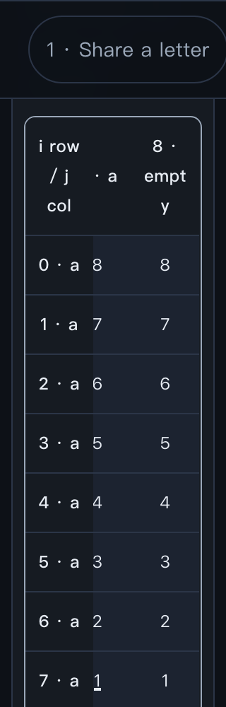

# Independent review — LeetCode 1092 header fit

**Reviewed candidate:** `c3d5761514ebedd5e50297acd937c5380ba12fe0`.
**Preview:** http://127.0.0.1:19892/leetcode/1092/.
**Reviewer:** independent delegated run `/root/review_1092_header`, 2026-10-26. Exact model identifier unavailable. This reviewer did not author the candidate.
**Target learner:** bilingual EN/ZH reader familiar with Python loops/arrays, new to shortest common supersequence DP.
**Frozen rubric:** `specs/leetcode-review-gates.md`; six weights 15/20/20/20/15/10, scores 0–4, threshold >=85, every dimension >=3, zero open required fixes. Python is the canonical language.

**Conclusion:** the identified candidate passes this independent local lesson review at **97.5/100**. Required finding **1092-R1 is closed against this candidate in the tested macOS Chromium environment**. No new required finding was observed. This is neither native campaign acceptance nor publication/public-delivery verification. The original Linux Chromium environment remains unverified. The central campaign ledger and its existing open R1/native campaign status were not changed; this local closure is evidence for the dispatcher, not an update to that ledger.

## Independence and cold walkthrough

Before opening the page, read only the applicable website-design skill and frozen rubric. No implementation, BRIEF, self-check, prior findings or author rationale was read before saving the cold record. Actual cold interaction used a fresh in-app browser tab; the later scripted checks used a separate headless Chromium context.

The complete question/action/observation/paraphrase record is [cold-walk.md](1092-header-independent-evidence-20261026/cold-walk.md). Its SHA-256 at the cold-phase handoff was `f339a091bfe33c1032c1985b42ce89d8224f163fb271135a9393e57da909000a`; it was not changed afterward. The dispatcher supplied R1 only after acknowledging that saved record.

The cold path established the following without author explanation:

- `ab/ac` needs at least a, b and c, and `abc` attains three; the visible position witnesses distinguish a subsequence from a substring. Emitting a/b/c matches the predicted consumed-prefix changes and retains all three steps.
- The baseline revisits suffix pairs through different emission orders. The mismatch counterexample `aab/baa` rejects always taking str1. The matching/mismatching case split explains both a lower bound and an attainable result, rather than merely presenting a formula.
- I predicted `(1,1)=2`, `(1,0)=3`, `(0,1)=3`, `(0,0)=3` before the corresponding reveals. The actual fill agreed. Reconstruction retained the path and showed `0+3`, `1+2`, `2+1`, `3+0`, preserving the shortest-length promise while consuming both inputs.
- I predicted `aba/bab` needs four before revealing the quiz: `abab` witnesses four, and distinct length-three inputs rule out three. The page's revealed explanation agreed.
- The visible `(1,1)->(2,1)` b/c tie maps directly to Python's `dp[i+1][j] <= dp[i][j+1]`, append str1, increment i. The costs distinguish the table, reconstruction and join; independent rows avoid aliasing; strings remain unchanged.
- Switching to Chinese preserved completed trace, hand history, selected answer, explanation and open disclosures. The Chinese proof retains the same matching argument, mismatch case split, lower bound, attainability and invariant.

A fresh independently chosen input, `aa/ab`, was recorded before execution: predicted length three with witness `aab`; counting distinct letters would wrongly give two. The UI is preset-only, so this was subsequently a **canonical Python code check**, not a custom-input UI experiment. It returned `aab` as predicted.

## Candidate identity and source boundary

HEAD was checked at the start and after testing and remained the exact candidate. All nine served assets were fetched and compared byte-for-byte with the checkout: index.html, local CSS, app.js, copy.js, core.js, python-code.js, solution.py, shared style.css and common.js. Their byte lengths and SHA-256 hashes are in [browser-audit.json](1092-header-independent-evidence-20261026/browser-audit.json). No tracked file was modified by the review.

The focused runtime diff from fix base `093440bf6df89b6a5dbc7a958ae3aef588b9acff` is limited to the local CSS URL token and three CSS lines bounding table headers to 52px (48px at the mobile breakpoint), allowing complete text to wrap. The base is not being described as accepted: R1 was still open. Application logic, dictionary, trace core, canonical Python, mirrored source and lesson metadata are byte-identical to that base. Native semantic table headers, sticky row/corner association and existing font size are retained.

Canonical/displayed/mirrored/copied/downloaded source is exact, including final newline. The browser's successful clipboard API value and download were compared to the canonical file. Independently induced clipboard failure in an isolated test context exposed the full source, focused it and selected all 1118 characters in both locales; this establishes fallback selection/source parity, **not a tested native system-copy shortcut**.

The required non-mutating preflight `python3 -B scripts/register_leetcode_lesson.py 1092 --validate-only` passed with exit 0. Local plus shared shipped CSS totals 11,623 uncompressed bytes. All observed page asset requests were local; no page errors occurred.

## 1092-R1 closure

Original finding is preserved in [1092-review-1-206ef9e2.md](1092-review-1-206ef9e2.md); this report does not overwrite its failure. That report identifies original candidate `5cf73ee858d9a8938b55206c867233a8397d60f6`, English 320×1000, CSS zoom 2, preset a×8/a×8, event 73/73, maximum table scroll, settled header below sticky navigation. In Linux Chromium 156 the sticky corner covered the leading `8 ·` of `8 · empty`; merely passing page-overflow checks was insufficient.

**Status:** closed for candidate `c3d5761514ebedd5e50297acd937c5380ba12fe0` in the independently tested local environment. **Severity:** original medium/required. **Owner action:** none remaining within the reviewed candidate/local scope. **Fix revision:** c3d5761514ebedd5e50297acd937c5380ba12fe0. **Reviewer recheck:** actual screenshots plus per-line Range geometry and independently reachable labels. Original Linux rendering remains an explicit unverified platform boundary, not claimed as reproduced or retested.

Exact targeted result on macOS Chromium **151.0.7922.34**, EN 320×1000 / CSS zoom 2 / a×8/a×8 / 73/73 / maximum scroll 357:

| Item | Actual rendered geometry |
| --- | --- |
| Sticky navigation bottom | y=140 |
| Wrapper | x=34…286, y=163.94 |
| Sticky corner | x=36…132 |
| Last column cell | x=186…282 |
| `8 ·` line | x=216.05…251.95, y=189.94…222.94 |
| `empt` line | x=204.20…263.80, y=231.94…264.94 |
| `y` line | x=227.52…240.48, y=273.94…306.94 |

Every line is right of the sticky corner and within the wrapper; the label is complete. Chinese `8 · 空` similarly occupies two complete lines beside the corner. All row headers remain attached to their corresponding row and stay inside their own cells. Screenshots were inspected at left, middle and maximum horizontal scroll; partially clipped neighboring columns at intermediate offsets are ordinary component scrolling, not an inaccessible label. Separate reachability checks repositioned each header into the available strip and verified **216 complete label exposures** across seven presets, two languages, 320/390 widths and CSS zoom 1/2. This tests actual text lines, not overlapping container boxes.

The complete word `empty` wraps as `empt` / `y`. This is legible and retains the index/empty-suffix meaning, but adds minor reading friction. It is an optional presentation improvement, not a renewed essential-content defect.

## Independent verification

Reviewer-owned scripts and raw output are retained under [1092-header-independent-evidence-20261026](1092-header-independent-evidence-20261026/). No author evidence was overwritten or used as a substitute for these observations.

- **Numerical execution:** reviewer Python harness ran the actual solution against all 196 binary-string pairs of lengths 1–3 using increasing-length output enumeration, plus independently selected `aa/ab`, `ba/ab`, `aaa/a`, `abc/def`, empty-side extensions and identical/disjoint 1000-character boundaries. Subsequence membership, optimum length and unchanged inputs passed. Empty input checks are extensions outside the official input domain. Details: [python-audit.json](1092-header-independent-evidence-20261026/python-audit.json).
- **Trace and translations:** every event of all seven presets was operated in both locales. Initial, equal, mismatch, ready, shared emission, takeA/tie, takeB, tailA and tailB all rendered the correct state-specific meaning. For example abac/cab event 14 says emit c from (0,0) to (0,1) because the right cost is smaller; Chinese says `右方代价更小，取 str2`. Mismatch explanations concern the actual DP choice, while clipboard fallback is separate copy-recovery text. AST analysis found 88 unique dictionary keys and no duplicates. All quiz answers were exercised; changing a choice hides stale feedback. Exact strings are in browser-audit.json.
- **State and controls:** initial Back/Reset and final Next/Complete are natively disabled; reset restores the initial trace. Keyboard Enter rewinds 73/73 to 72/73 then restores 73/73; the table has a 3px visible focus outline and accepts horizontal arrow scrolling. Tab traversal follows collection, language controls, official link, lesson navigation, enabled hand action, baseline disclosure and preset. Locale switches retain progress, diagram/output/history and open source detail. Forced-colors mode retains the star, current-cell outline and path underline. Reduced-motion preference was enabled during responsive checks.
- **Responsive matrix:** 14 configurations: EN/ZH at 320×1000, 390×844, 736×390 and 1440×1000 at CSS zoom 1; 320×1000, 390×844 and 1440×1000 at CSS zoom 2. Longest preset inspected at dense fill event 32 and final reconstruction, with left/middle/right geometry. No page overflow. Independent header reachability adds all seven presets at 320/390 and both zoom levels. The rightmost label was readable in all recorded configurations. See [header-reachability.json](1092-header-independent-evidence-20261026/header-reachability.json).
- **Contrast and locality:** sampled authored text/surface pairs pass AA and the requested core 7:1 target: body 13.40, muted/disabled 7.08, current/focus orange 8.94, cyan 13.10, explanatory text 12.89. These are measured opaque pairs, not claims about every possible composited/system palette. Forced colors were also visually inspected. No external runtime asset requests were recorded.

The first reviewer harness attempt mistakenly selected the JavaScript strict-mode directive instead of the dictionary assignment for AST inspection; only the reviewer script was corrected, then the complete audit passed. This was not a candidate defect.

## Scores

| Dimension | Weight | Score / 4 | Weighted | Observation basis |
| --- | ---: | ---: | ---: | --- |
| Problem, terms, hand calculation | 15 | 4 | 15 | Ordered subsequence witnesses, actual string output, attainable three-letter bound. |
| Causal derivation and saved work | 20 | 4 | 20 | Repeated suffix pairs, explicit failed greedy rule, complete matching/mismatch derivation. |
| Maintained state and correctness | 20 | 4 | 20 | Filled-cell meaning, neighbor order, bases, reconstruction equality and termination independently reconstructed. |
| Interaction and visual meaning | 20 | 4 | 20 | Predictions agree with actual events; retained path and output distinguish values from star/underline markers. |
| Transfer to Python and cost | 15 | 4 | 15 | Concrete visible-to-code mapping, exact source parity, fresh case/oracle execution, correct table/output costs. |
| Bilingual and device access | 10 | 3 | 7.5 | Equivalent reasoning, retained state and keyboard controls; repaired complete labels with minor within-word wrapping friction. |
| **Total** | **100** | | **97.5** | Every dimension >=3; no open required fix within the tested scope. |

## Priority and verification limits

The highest-return slice is preserving complete row/column identity while retaining the semantic, scrollable table. **P0:** R1 closure, bilingual reasoning, controls and source/state checks are complete for this candidate locally. **P1:** optional 1092-O1 — improve whole-word wrapping for `empty` where space permits, only if the narrow-zoom visibility guarantee survives; no change is required for this review. **P2:** no decoration work is needed.

**Deferred:** original Linux Chromium 156 recheck (requires that environment); native browser-menu zoom, physical phone/virtual keyboard and assistive-technology reading (require those actual surfaces); human novice comprehension study (requires learners); public delivery and successful online submission (outside this local review). CSS zoom is layout stress, not physical-device or native-zoom proof. No campaign state, Pi, production, commit, push or deployment was changed by this reviewer.

The dispatcher separately added an untracked provenance document while review was running; candidate HEAD and lesson assets stayed unchanged. This report and its exclusive evidence directory are the only reviewer-owned writes. Evidence hashes are in `manifest.json` within that directory; the report hash is an entry in the manifest.
